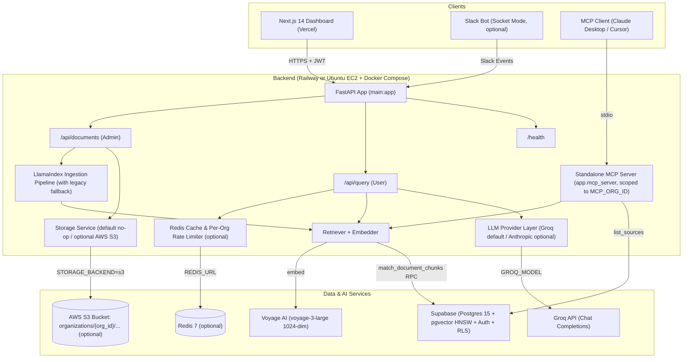

# Company Knowledge Assistant

> A multi-tenant RAG (Retrieval-Augmented Generation) SaaS that lets employees ask questions about internal HR policies, SOPs, and onboarding guides — and get instant, accurate, source-cited answers instead of messaging HR/IT.

---

## Architecture Overview



---

## Monorepo Structure

```
/
├── .env.example              # All env vars reference
├── README.md
├── backend/                  # FastAPI app
│   ├── Dockerfile
│   ├── railway.toml
│   ├── pyproject.toml
│   ├── main.py
│   ├── .env.example
│   ├── supabase/functions/
│   │   └── match_document_chunks.sql
│   ├── evaluation/           # RAGAS evaluation suite (optional)
│   │   ├── dataset/
│   │   │   └── eval_questions.json
│   │   ├── build_dataset.py
│   │   ├── run_ragas.py
│   │   └── results/          # git-ignored output
│   └── app/
│       ├── core/             # config, supabase client
│       ├── api/              # routes + deps
│       ├── services/         # parser, chunker, embedder, retriever, llm
│       └── slack/            # Slack Bolt bot
├── frontend/                 # Next.js 14 App Router
│   ├── src/
│   │   ├── app/              # pages: login, dashboard, analytics, chat
│   │   ├── components/       # DocumentUploader, ChatWindow, charts…
│   │   └── lib/              # supabase client, api helpers
│   └── .env.example
└── docs/
    ├── schema.sql            # Full Postgres DDL (run in Supabase SQL Editor)
    ├── schema_diagram.md     # ERD
    └── slack_setup.md        # Slack app creation guide
```

---

## Tech Stack

| Layer | Technology |
|-------|-----------|
| Backend | Python 3.11+, FastAPI, uvicorn |
| Database | Supabase (Postgres 15 + pgvector HNSW) |
| Auth | Supabase Auth (Bearer JWT + `users` table role lookup) |
| Embeddings | Hugging Face `Qwen/Qwen3-Embedding-8B` (`huggingface_hub` InferenceClient, 1024-dim MRL) / Voyage AI `voyage-3-large` (1024-dim) / OpenAI `text-embedding-3-small` fallback |
| LLM | Groq (official `groq` SDK; model configured via `GROQ_MODEL`), optional Anthropic path via `LLM_PROVIDER=anthropic` |
| Document Parsing & Ingestion | LlamaIndex (`llama-index-core`, `llama-index-readers-file`, `SentenceSplitter`) with automatic fallback to `unstructured` + `pypdf` + `python-docx` |
| Caching & Rate Limiting | Redis (`redis` for per-org query caching + per-org rate limiting via `REDIS_URL`; `slowapi` in-memory per-IP fallback) |
| File Storage | Optional AWS S3 (`boto3`, `organizations/{org_id}/...` prefix via `STORAGE_BACKEND=s3`; default `supabase` mode does not archive raw files) |
| MCP | Official `mcp` Python SDK (`python -m app.mcp_server`, read-only tools scoped by `MCP_ORG_ID`) |
| Frontend | Next.js 14 (App Router), TypeScript, Tailwind CSS |
| Charts | recharts |
| Slack | Slack Bolt SDK (Socket Mode, optional) |
| Backend hosting | Railway (`Dockerfile` + `railway.toml`) or Ubuntu EC2 with Docker Compose (see [`DEPLOYMENT.md`](DEPLOYMENT.md)) |
| Frontend hosting | Vercel |

---

## Prerequisites

- Python 3.11+
- Node.js 18+
- A [Supabase](https://supabase.com) project (free tier works)
- A [Voyage AI](https://www.voyageai.com) API key **or** OpenAI API key
- A [Groq](https://console.groq.com) API key (free tier works; check Groq's current model list for `GROQ_MODEL`)
- A [Slack App](https://api.slack.com/apps) (for Milestone 5 only)

---

## Local Setup

### 1. Clone & set up environment files

```bash
git clone <your-repo-url>
cd <repo-root>

# Backend
cp .env.example backend/.env
# Edit backend/.env with your real keys

# Frontend
cp frontend/.env.example frontend/.env.local
# Edit frontend/.env.local with your Supabase URL + anon key
```

### 2. Set up the database

1. Open your [Supabase project](https://app.supabase.com) → **SQL Editor**
2. Paste the entire contents of `docs/schema.sql`
3. Click **Run**
4. Verify: you should see tables `organizations`, `users`, `documents`, `document_chunks`, `query_logs` in the Table Editor

### 3. Run the backend

```bash
cd backend

# Install uv (fast Python package manager)
pip install uv

# Create virtualenv and install deps
uv venv
uv pip install -e .

# Activate venv (Windows)
.venv\Scripts\activate

# Start dev server
uvicorn main:app --reload --port 8000
```

Backend will be available at `http://localhost:8000`
- API docs: `http://localhost:8000/docs`
- Health check: `http://localhost:8000/health`

### 4. Run the frontend

```bash
cd frontend
npm install
npm run dev
```

Frontend will be available at `http://localhost:3000`

### 5. Test the full flow

1. Create an organization and admin user in Supabase Auth
2. Upload a PDF via the dashboard
3. Watch status change from `processing` → `ready`
4. Ask a question in the chat tab
5. View analytics in the dashboard

---

## Environment Variables Reference

### Backend (`backend/.env`)

| Variable | Required | Description |
|----------|----------|-------------|
| `SUPABASE_URL` | ✅ | Your Supabase project URL |
| `SUPABASE_SERVICE_ROLE_KEY` | ✅ | Service role key (bypasses RLS) — keep secret |
| `SUPABASE_ANON_KEY` | ✅ | Public anon key |
| `VOYAGE_API_KEY` | ✅* | Voyage AI key for embeddings |
| `OPENAI_API_KEY` | ✅* | OpenAI key (fallback if no Voyage key) |
| `LLM_PROVIDER` | ❌ | `groq` (default) or `anthropic` |
| `GROQ_API_KEY` | ✅ | Groq API key |
| `GROQ_MODEL` | ✅ | Groq model name — no default in code; pick one from [Groq's current model list](https://console.groq.com/docs/models) |
| `LLM_MAX_RETRIES` | ❌ | Retries with backoff on Groq rate limits (default `3`) |
| `ANTHROPIC_API_KEY` / `ANTHROPIC_MODEL` | ❌ | Only if `LLM_PROVIDER=anthropic` |
| `INGESTION_PIPELINE` | ❌ | `llamaindex` (default, auto-fallback) or `legacy` |
| `SIMILARITY_THRESHOLD` | ❌ | Minimum cosine similarity for retrieval (default `0.3`) |
| `EMBEDDING_DIMENSION` | ❌ | `1024` (Voyage) or `1536` (OpenAI) |
| `SLACK_BOT_TOKEN` | ❌ | Required for Slack bot only |
| `SLACK_SIGNING_SECRET` | ❌ | Required for Slack bot only |
| `SLACK_APP_TOKEN` | ❌ | Required for Slack bot Socket Mode |
| `QUERY_RATE_LIMIT` | ❌ | Defaults to `10/minute` |
| `REDIS_URL` | ❌ | Optional Redis URL for per-org query caching and per-org rate limiting (falls back to in-memory if unset) |
| `CACHE_TTL_SECONDS` | ❌ | Redis query cache TTL in seconds (default `3600`) |
| `MAX_RETRIEVED_CHUNKS` | ❌ | Defaults to `5` |
| `CORS_ORIGINS` | ❌ | Comma-separated allowed origins |
| `MCP_ORG_ID` | ❌ | Organization UUID when running the standalone MCP server (`python -m app.mcp_server`) |
| `STORAGE_BACKEND` | ❌ | `supabase` (default no-op archival, existing behavior) or `s3` (stores raw files in S3 under `organizations/{org_id}/...`) |
| `S3_BUCKET_NAME` | ❌ | S3 bucket name when `STORAGE_BACKEND=s3` |
| `AWS_REGION` | ❌ | AWS region for `boto3` when `STORAGE_BACKEND=s3` (credentials come from the standard AWS chain / EC2 IAM role) |

*One of `VOYAGE_API_KEY` or `OPENAI_API_KEY` is required.

### Frontend (`frontend/.env.local`)

| Variable | Required | Description |
|----------|----------|-------------|
| `NEXT_PUBLIC_SUPABASE_URL` | ✅ | Supabase project URL |
| `NEXT_PUBLIC_SUPABASE_ANON_KEY` | ✅ | Supabase anon/public key |
| `NEXT_PUBLIC_BACKEND_URL` | ✅ | Backend URL (local: `http://localhost:8000`) |

---

## Run with Docker

```bash
# 1. Create backend/.env from the template and fill in your own values
cp backend/.env.example backend/.env

# 2. Build and start the backend (http://localhost:8000)
docker compose up --build -d

# 3. Check it
curl http://localhost:8000/health
docker compose ps          # STATUS should become "healthy"
docker compose logs -f backend

# Stop
docker compose down
```

The image (`backend/Dockerfile`) uses a multi-stage build (uv installs from `pyproject.toml`, dependency files copied first for layer caching), runs as a non-root user, installs only the system packages the document parsers need, has a `HEALTHCHECK` on `/health`, and honors the `PORT` variable (Railway sets it; default 8000). `docker compose config` works even before `backend/.env` exists, but the app needs real keys to answer questions.

## Deployment

### Backend → Railway

1. Push to GitHub
2. Create a new Railway project → "Deploy from GitHub repo"
3. Select the `backend/` directory as root (or use the provided `railway.toml`)
4. Add all environment variables from `backend/.env.example` in Railway's settings
5. Railway will auto-detect the `Dockerfile` and build

### Frontend → Vercel

1. Push to GitHub
2. Create a new Vercel project → import repo
3. Set **Root Directory** to `frontend/`
4. Add environment variables from `frontend/.env.example`
5. Deploy

### Backend → Ubuntu EC2 (Docker Compose + Caddy/Nginx + Optional S3)

See [`DEPLOYMENT.md`](DEPLOYMENT.md) for the complete Linux/EC2 deployment guide (billing alert, least-privilege S3 IAM role, Docker installation, `docker compose` stack, HTTPS with Caddy or Nginx, and stopping the instance).

---

## API Endpoints

| Method | Endpoint | Auth | Description |
|--------|----------|------|-------------|
| GET | `/health` | None | Health check |
| POST | `/api/documents/upload` | Admin JWT | Upload + index a document |
| GET | `/api/documents` | Admin JWT | List org's documents |
| GET | `/api/documents/{id}/status` | Admin JWT | Poll ingestion status |
| DELETE | `/api/documents/{id}` | Admin JWT | Delete doc + chunks |
| POST | `/api/query` | User JWT | Ask a question (RAG) |

---

## Evaluation (RAGAS)

The project includes a [RAGAS](https://docs.ragas.io/)-based evaluation suite that measures retrieval and generation quality **without changing any application behavior**. It lives in `backend/evaluation/` and is installed as an optional dependency group so the production Docker image stays lean.

### Metrics

| Metric | What it measures |
|--------|-----------------|
| **Faithfulness** | Is the generated answer grounded in the retrieved contexts? |
| **Response Relevancy** | Does the answer directly address the user's question? |
| **Context Precision** | Are the most relevant chunks ranked highest? |
| **Context Recall** | Did the retriever fetch all the information needed to answer? |

### Quick Start

```bash
cd backend

# 1. Install eval dependencies (in addition to the main app deps)
uv pip install -e ".[eval]"

# 2. Make sure backend/.env has GROQ_API_KEY, VOYAGE_API_KEY, and EVAL_ORG_ID set
#    EVAL_ORG_ID should be the UUID of an org that already has documents indexed.

# 3. Build the evaluation dataset (runs each question through the real pipeline)
python -m evaluation.build_dataset
#    → outputs: evaluation/results/eval_dataset.json

# 4. Run RAGAS metrics
python -m evaluation.run_ragas
#    → outputs: evaluation/results/ragas_scores.json
#               evaluation/results/ragas_scores.csv
```

### Notes

- The `eval` dependency group includes `ragas`, `langchain-groq`, and `langchain-voyageai`. These are **not** installed in the Railway Docker image.
- **Groq free-tier rate limits**: `build_dataset.py` pauses between queries (configurable via `EVAL_QUERY_DELAY` env var, default 6 s). `run_ragas.py` uses `RunConfig(max_workers=2, max_retries=10)` to stay within limits.
- The 10 sample questions in `evaluation/dataset/eval_questions.json` are **placeholder data** — replace them with real questions and ground-truth answers from your organisation's uploaded documents for meaningful results.
- `evaluation/results/` is git-ignored; results are generated locally and may contain org-specific data.

---

## Key Design Decisions

- **LlamaIndex for ingestion only**: `app/services/ingestion.py` uses LlamaIndex readers (PDF, DOCX), an `IngestionPipeline` with `SentenceSplitter` for node parsing/chunking (sized to match the old 2000-char / 200-overlap chunks), and per-node metadata (`org_id`, `document_id`, source filename). Embeddings, pgvector storage, the `match_document_chunks` function and retrieval are still written directly and do not use LlamaIndex, and the stored chunk format is unchanged. If LlamaIndex fails for a file, the original parser + chunker run instead (`INGESTION_PIPELINE=legacy` forces the old path). Why: maintained readers and splitters instead of our own; nothing else was moved so retrieval behavior stays identical
- **pgvector HNSW**: no training step, online inserts, excellent recall at < 1M chunks
- **Flexible 1024-dim embeddings (Qwen / Voyage AI / OpenAI)**: `app/services/embedder.py` supports `Qwen/Qwen3-Embedding-8B` via Hugging Face `InferenceClient` (sliced and L2-normalized to 1024 dimensions to match the schema) and automatically falls back to Voyage AI `voyage-3-large` (1024-dim) or OpenAI `text-embedding-3-small` if configured
- **Groq LLM behind a small provider layer**: `app/services/llm.py` keeps one `generate_answer()` signature; Groq is the default (free tier, official `groq` SDK, model set via `GROQ_MODEL`) and Anthropic stays as an optional path (`LLM_PROVIDER=anthropic`). Rate limits are retried with exponential backoff (honoring `Retry-After`), then the user gets a clear 429/503 message
- **Strict anti-hallucination prompt**: the system prompt explicitly forbids outside knowledge and instructs the model to punt to HR/IT (`was_answered_confidently=false`) when retrieved context is insufficient
- **Optional Redis caching & per-org rate limiting**: when `REDIS_URL` is set, answers are cached under `rag:{org_id}:v{docver}:q:{sha256}` and automatically invalidated by bumping `docver` on document upload/delete, and requests are rate-limited per organization (`rl:{org_id}:...`); when `REDIS_URL` is unset, the app falls back to no cache and `slowapi`'s in-memory per-IP limiter
- **Optional S3 archival & standalone MCP server**: `STORAGE_BACKEND=s3` archives raw uploaded files to S3 under `organizations/{org_id}/...` via `boto3`'s standard credential chain, and `python -m app.mcp_server` exposes read-only tools (`search_knowledge_base`, `list_sources`) pinned to a single tenant via `MCP_ORG_ID`
- **Multi-tenant from day 1**: every database table, Redis key, S3 object prefix, and MCP query is scoped by `org_id`; RLS is enforced in Postgres and the service-role key is used only server-side

---

## Slack Setup

See [`docs/slack_setup.md`](docs/slack_setup.md) for the full Slack app configuration guide.

---

## MCP Server (Model Context Protocol)

The backend includes a separate, read-only MCP server (`backend/app/mcp_server.py`) that exposes your organization's knowledge base as tools to MCP-compatible clients (such as Claude Desktop or Cursor):

- `search_knowledge_base(query)` — runs vector similarity search via the existing retrieval pipeline and returns matching passages with source metadata.
- `list_sources()` — lists all `ready` documents in the organization's knowledge base.

### Tenancy & Security

- The MCP server is pinned to a single organization via the `MCP_ORG_ID` environment variable; tool arguments cannot override `org_id` or query across tenants.
- `SUPABASE_SERVICE_ROLE_KEY` and API keys stay in the local server environment and are never returned in tool outputs.

### Running the MCP Server

```bash
cd backend
MCP_ORG_ID=<your-org-uuid> python -m app.mcp_server
```

### Connecting an MCP Client (e.g., Claude Desktop)

Add an entry to your client's `claude_desktop_config.json` (or `.cursor/mcp.json`):

```json
{
  "mcpServers": {
    "company-knowledge-assistant": {
      "command": "/absolute/path/to/backend/.venv/bin/python",
      "args": ["-m", "app.mcp_server"],
      "cwd": "/absolute/path/to/backend",
      "env": {
        "MCP_ORG_ID": "your-org-uuid-here"
      }
    }
  }
}
```
(When `cwd` is `backend/`, `app.core.config` automatically loads the remaining keys from `backend/.env`.)

---

## Contributing

1. Backend formatting: `ruff format` + `ruff check`
2. Frontend formatting: `prettier` + `eslint`
3. No secrets in code — use `.env` files only
