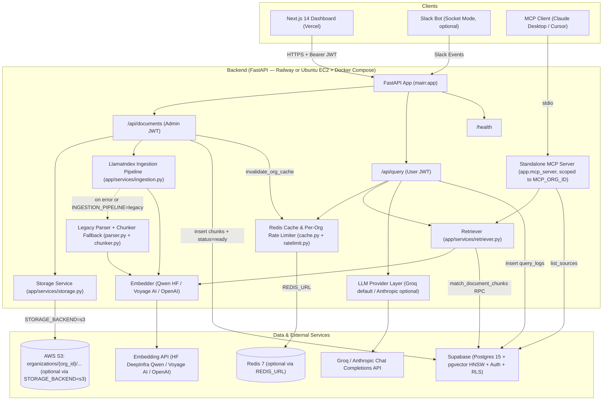

# Architecture Overview

## System Diagram

---

## Ingestion Flow (`POST /api/documents/upload`)

1. **Auth & Validation:** `require_admin` verifies the caller's Supabase Bearer JWT and checks that `users.role == "admin"` for the resolved `org_id`. The endpoint validates the file extension (`.pdf`, `.docx`, `.doc`, `.txt`) and size (up to 50 MB).
2. **Metadata Row:** A row is inserted into `documents` scoped to `org_id` with `status = 'processing'`, and the HTTP endpoint immediately returns `202 Accepted` with the `document_id`.
3. **Background Task (`_ingest_document`):**
   - **Optional S3 Archival:** When `STORAGE_BACKEND=s3`, `store_document_file()` uploads the raw bytes to `s3://<S3_BUCKET_NAME>/organizations/{org_id}/{unique_filename}` using `boto3`. When `STORAGE_BACKEND=supabase` (the default), raw file archival is a no-op.
   - **Document Reading & Chunking:** `ingest_chunks()` runs the LlamaIndex pipeline (`PDFReader`, `DocxReader`, or UTF-8 `.txt` reader → `IngestionPipeline` with `SentenceSplitter` targeting ~500 tokens / ~2000 characters with ~50 tokens / ~200 characters overlap, attaching `org_id`, `document_id`, and `filename` metadata to each node while excluding metadata keys from the stored chunk text). If LlamaIndex fails or `INGESTION_PIPELINE=legacy` is set, it falls back to `parse_document()` (`unstructured` → `pypdf` / `python-docx`) + `chunk_text()`.
   - **Embedding:** `embed_texts()` generates 1024-dimensional vectors via Hugging Face `InferenceClient` (`Qwen/Qwen3-Embedding-8B`), falling back automatically to Voyage AI (`voyage-3-large`) or OpenAI (`text-embedding-3-small`).
   - **Storage & Cache Invalidation:** Chunks and embeddings are inserted into `document_chunks` in batches of 50, `documents.status` is updated to `'ready'` (or `'failed'` with `error_msg` on exception), and `invalidate_org_cache(org_id)` increments `rag:{org_id}:docver` in Redis so stale cached answers for that organization are never served.

---

## Query Flow (`POST /api/query`)

1. **Auth & Rate Limiting:** `get_current_user` resolves `user_id` and `org_id` from the Supabase JWT. `slowapi` enforces the per-IP limit, and when `REDIS_URL` is configured, `check_org_rate_limit(org_id)` enforces the per-organization fixed-window rate limit (`QUERY_RATE_LIMIT`, default `10/minute`) under key `rl:{org_id}:{window}:{bucket}`.
2. **Per-Org Redis Cache Lookup:** When `REDIS_URL` is set, `get_cached_answer(org_id, question)` normalizes the question (lowercase + collapsed whitespace), reads the organization's current document version (`rag:{org_id}:docver`), and checks `rag:{org_id}:v{docver}:q:{sha256}`. On a hit, the cached answer and sources are logged to `query_logs` and returned immediately.
3. **Vector Retrieval (`retrieve_chunks`):** On a cache miss, `embed_query(question)` embeds the question and calls the Postgres RPC `match_document_chunks(query_embedding, p_org_id, match_count, similarity_threshold)` to fetch up to `MAX_RETRIEVED_CHUNKS` (default `5`) chunks belonging strictly to `org_id` with cosine similarity $\ge$ `SIMILARITY_THRESHOLD` (default `0.3`).
4. **Grounded Answer Generation (`generate_answer`):**
   - If no chunks are returned, the service short-circuits without calling the LLM and returns the punt message (`"I don't have information about that in the uploaded documents — please contact HR/IT directly."`, `was_answered_confidently = False`).
   - Otherwise, `app/services/llm.py` formats the chunks with their source names and calls the configured provider (`LLM_PROVIDER=groq` with `GROQ_MODEL` by default, or `anthropic`), retrying rate-limit (`429`) and transient errors with exponential backoff. Confidence is set to `False` if the response contains `PUNT_PHRASE`.
5. **Audit Logging & Caching:** The question, answer, retrieved chunk IDs, `was_answered_confidently`, and `latency_ms` are written to `query_logs` (used by `GET /api/query/analytics/summary`), the response is stored in Redis with `CACHE_TTL_SECONDS`, and the deduplicated source documents + answer are returned to the caller.
