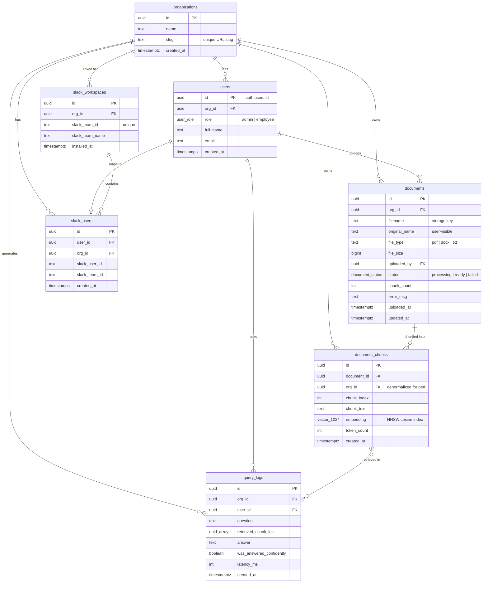

# Database Schema Diagram

Entity-relationship diagram for the Company Knowledge Assistant multi-tenant RAG system.

## Key Design Decisions

| Decision | Reason |
|----------|--------|
| `org_id` denormalized on `document_chunks` | Avoids a JOIN on every vector search — cosine similarity scan + org filter happens in one index pass |
| HNSW index (not IVFFlat) | No training/`VACUUM` step; better recall at small-to-medium scale (<1M chunks); online updates |
| `vector(1024)` | Voyage AI `voyage-3-large` dimensions; change to `vector(1536)` for OpenAI `text-embedding-3-small` |
| `users.id` = `auth.users.id` | Direct JWT → user resolution without extra lookup; Supabase Auth manages the auth side |
| RLS on all tables | Service-role key (backend) bypasses for writes; protects against accidental anon API exposure |
| `similarity_threshold = 0.3` in function | Filters out low-relevance chunks before returning; prevents garbage context in LLM prompt |
